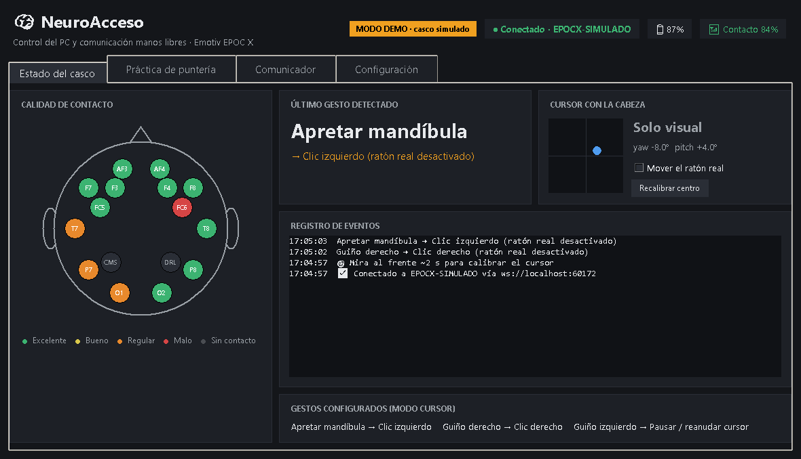
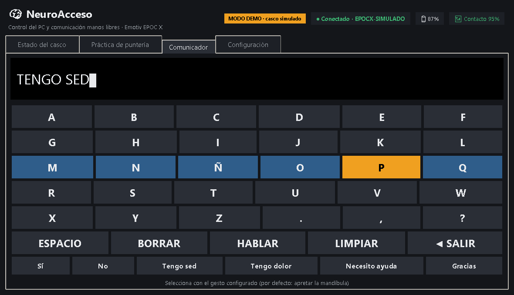
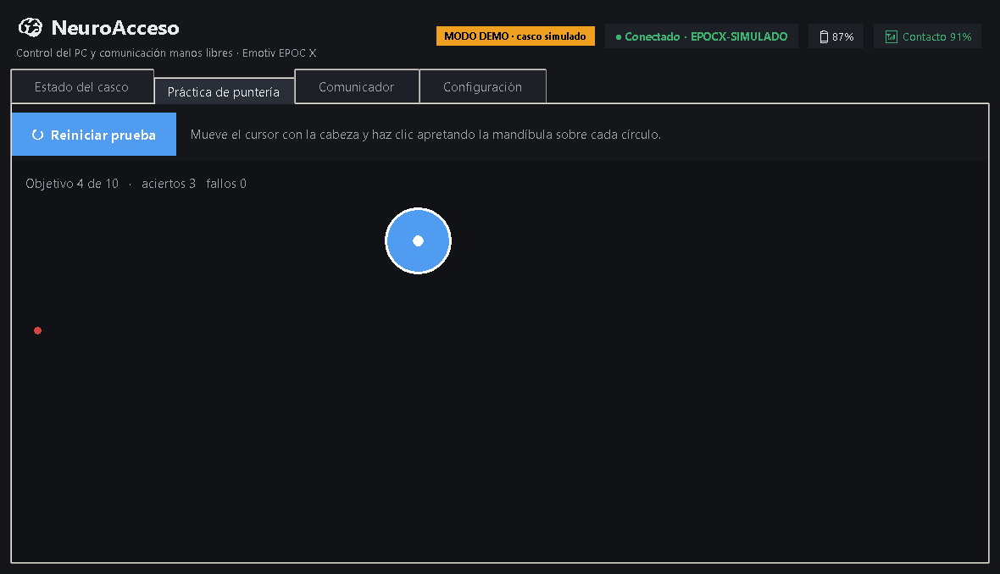
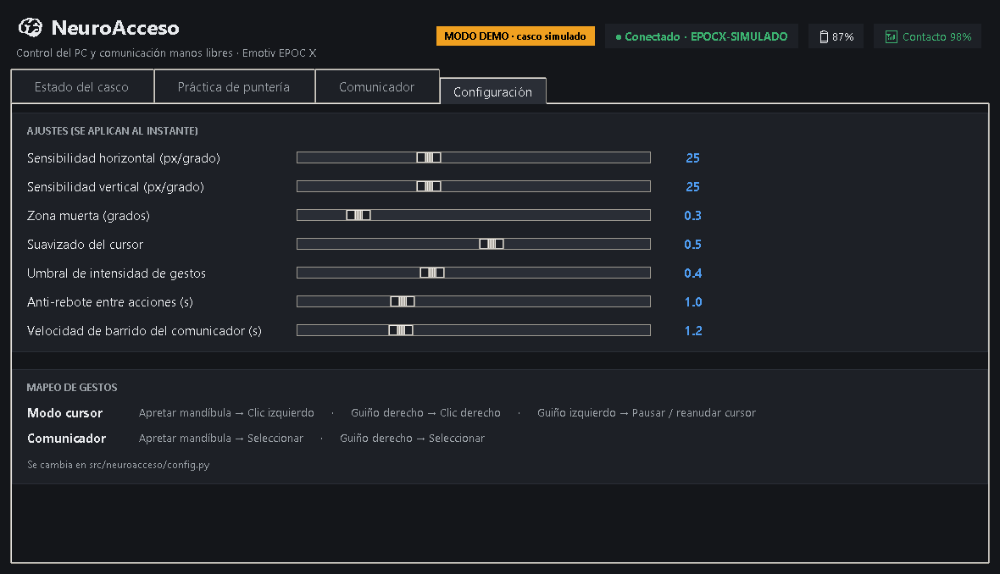
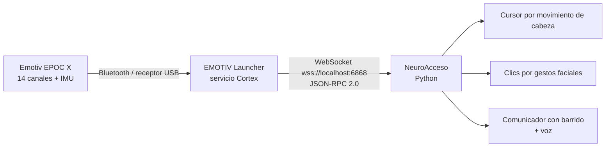

# NeuroAcceso 🧠🖱️

**Control del computador y comunicación manos libres con el casco EEG Emotiv EPOC X.**

Propuesta de proyecto de software · Universidad Católica de Cuenca · 2026

> **Estado (noviembre 2026): de prototipo a sistema real.** El **prototipo** está en `legacy/` (Python + tkinter, con demo sin casco). El sistema definitivo se construye en paralelo en dos partes — **motor** (Santiago) e **interfaz** (Jonnathan) — unidas por un contrato. **El motor (backend) está completo**: API v1, casco real y simulado, modos, calibración, métricas, base de datos, ejecutable de escritorio y 83 pruebas automáticas ([backend/README.md](backend/README.md)). **La interfaz (frontend) está completa** en la rama `interfaz/v1`: las 12 pantallas, barrido, voz sin internet, predicción de palabras, práctica ISO 9241-411, historial con gráficas, encuesta SUS, 390 pruebas y auditoría de accesibilidad sin problemas ([frontend/README.md](frontend/README.md)). Falta lo que necesita el casco real: los puntos de integración.
> - 📋 [División del trabajo](docs/division-del-trabajo.md)
> - 🏗️ [Arquitectura del sistema](docs/arquitectura-sistema.md)
> - 🖥️ [Especificación de pantallas](docs/pantallas.md)
> - 🤝 [Contrato API v1 (borrador)](contrato/api-v1.md)

---

## 1. El problema

Las personas con movilidad reducida severa (lesión medular, ELA, parálisis cerebral, accidentes cerebrovasculares) a menudo no pueden usar un ratón ni un teclado, y en algunos casos tampoco pueden hablar. Las soluciones comerciales de accesibilidad (seguidores oculares, comunicadores dedicados) son caras y poco accesibles en nuestro medio.

## 2. La solución

**NeuroAcceso** es una aplicación de escritorio que usa el casco **Emotiv EPOC X** (que la universidad ya tiene) para que una persona pueda:

| Función | Cómo se controla |
|---|---|
| 🖱️ **Mover el cursor** | Girando la cabeza (giroscopio/IMU del casco) |
| 👆 **Clic izquierdo** | Apretando la mandíbula (*clench*) |
| 👉 **Clic derecho** | Guiño del ojo derecho |
| ⏸️ **Pausar / reanudar el cursor** | Guiño del ojo izquierdo |
| ⌨️ **Escribir** | Teclado en pantalla con barrido automático; se selecciona con un gesto |
| 🔊 **Hablar** | El texto escrito y las frases rápidas se leen en voz alta |
| 🧠 **Comando mental (fase avanzada)** | Comando "empujar" entrenado, como acción alternativa |

**Costo: $0.** Solo usa el casco existente, un PC y software gratuito.

### 🎬 Demo sin casco

```bash
cd legacy
pip install -e ".[demo]"
python -m neuroacceso --demo
```

Abre la aplicación conectada a un **casco simulado** que habla el mismo protocolo que Emotiv Cortex: las flechas mueven la cabeza y las teclas C / Q / E hacen los gestos. Guion de presentación y detalles en **[docs/demo.md](docs/demo.md)**.

| Estado del casco | Comunicador |
|---|---|
|  |  |
| **Práctica de puntería** | **Configuración** |
|  |  |

## 3. ¿Por qué es factible?

- El EPOC X incluye **gratis la API básica de Emotiv (Cortex)**, que entrega en tiempo real:
  - **Expresiones faciales** (`fac`): parpadeo, guiños, mandíbula, sonrisa, cejas.
  - **Movimiento** (`mot`): acelerómetro, magnetómetro y giroscopio/cuaterniones.
  - **Comandos mentales** (`com`), **bandas de potencia** (`pow`) y **calidad de contacto** (`dev`).
- El **EEG crudo no es necesario** (es lo único que requiere licencia de pago).
- Las expresiones faciales y el movimiento son las detecciones **más fiables** del casco.
- Emotiv documenta este uso para comunicación de personas con discapacidad, y hay estudios que validan el uso de guiños para controlar dispositivos de asistencia (ver [referencias](#11-referencias)).

## 4. Cómo funciona



Detalle completo en [docs/arquitectura.md](docs/arquitectura.md) y [docs/cortex-api.md](docs/cortex-api.md).

## 5. Tecnologías

| Componente | Tecnología | Costo |
|---|---|---|
| Lenguaje | **Python 3.10+** | Gratis |
| Conexión con el casco | **Emotiv Cortex API** vía WebSocket (`websocket-client`) | Gratis (incluida con EPOC X) |
| Software de Emotiv | **EMOTIV Launcher** (+ EmotivBCI para entrenar) | Gratis |
| Control de ratón/teclado | `pyautogui` | Gratis |
| Interfaz gráfica | `tkinter` (incluido en Python) | Gratis |
| Texto a voz | `pyttsx3` (usa las voces de Windows, funciona sin internet) | Gratis |
| Configuración | `python-dotenv` | Gratis |
| Control de versiones | Git + GitHub | Gratis |
| Editor | VS Code | Gratis |

**Hardware:** Emotiv EPOC X (ya disponible), receptor USB o Bluetooth del PC, solución salina para los sensores, PC con Windows 10/11 o macOS.

## 6. Estructura del repositorio

```
neuroacceso/
├── backend/        ← MOTOR (Santiago): servicio Python + FastAPI — versión 1.0 completa
├── frontend/       ← INTERFAZ (Jonnathan): React + TypeScript — versión 1.0 completa
├── contrato/       ← API v1 que une motor e interfaz
├── legacy/         ← prototipo funcional (tkinter) con demo sin casco
├── docs/           ← arquitectura, pantallas, división del trabajo, guías
└── .github/        ← integración continua y CODEOWNERS
```

## 7. Inicio rápido

> Guía detallada (cuenta de Emotiv, Client ID, colocación del casco): **[docs/guia-inicio.md](docs/guia-inicio.md)**

**Motor (backend)** — requiere [uv](https://docs.astral.sh/uv/):
```bash
cd backend
uv sync
uv run pytest -q
uv run python -m neuroacceso_motor
```

**Prototipo (legacy)** — ver [legacy/README.md](legacy/README.md):
```bash
cd legacy
pip install -e ".[demo,dev]"
python -m neuroacceso --demo
```

## 8. Plan de trabajo

El sistema real se construye en **12 semanas** (desde el 16 de noviembre de 2026), en dos partes independientes:

| Fase | Semanas | Motor — Santiago | Interfaz — Jonnathan |
|---|---|---|---|
| F0 | 1 | Monorepo, CI, FastAPI con seguridad local | Proyecto React + TS, design tokens, cliente WS |
| F1 | 2–4 | Fuentes (Cortex, simulador, replay), cursor, gestos, WebSocket | Estructura de la app, pantalla Estado, mocks |
| F2 | 5–7 | Base de datos, perfiles, máquina de modos, ejecutable | Onboarding, ajustes, perfiles, comunicador con voz |
| F3 | 8–9 | Entrenamiento Cortex, comando mental, métricas Fitts | Entrenamiento, práctica de puntería, predicción de palabras |
| F4 | 10–11 | Robustez, latencia, instalador | Informes, auditoría de accesibilidad |
| F5 | 12 | Protocolo de pruebas, CSV | Video demo, SUS |

Detalle, reglas de trabajo y puntos de integración: **[docs/division-del-trabajo.md](docs/division-del-trabajo.md)**. Las tareas están como *issues* en GitHub con milestones F0–F5.

## 9. Cómo se medirá el éxito

- **Precisión de gestos:** % de gestos reconocidos correctamente y falsos positivos por minuto.
- **Velocidad de escritura:** caracteres por minuto en el comunicador.
- **Tarea de puntería:** tiempo para hacer clic en objetivos en pantalla (prueba tipo Fitts).
- **Usabilidad:** cuestionario SUS (System Usability Scale) aplicado a voluntarios.

## 10. Alcance y limitaciones

- No es un dispositivo médico; es un **prototipo académico**.
- No usa EEG crudo (requiere licencia de pago); se basa en las detecciones gratuitas de Cortex.
- Los comandos mentales requieren entrenamiento por usuario y son menos fiables que los gestos; por eso son opcionales.
- Ver [docs/riesgos.md](docs/riesgos.md).

## 11. Referencias

- Cortex API (oficial): https://emotiv.gitbook.io/cortex-api
- Ejemplos oficiales de Emotiv: https://github.com/Emotiv/cortex-example
- Emotiv y comunicación para personas con discapacidad: https://www.emotiv.com/knowledge-base/emotiv-disability-communication-tech
- Clasificación de guiños para dispositivos de asistencia (SN Applied Sciences, 2020): https://shdl.mmu.edu.my/7987/
- Validación del EPOC Flex para investigación EEG/ERP (PeerJ, 2020): https://peerj.com/articles/9713
- Proyecto similar con EPOC X (Grand Canyon University): https://aigcu.github.io/EEG-Game-Website/

## Licencia

MIT — ver [LICENSE](LICENSE).
