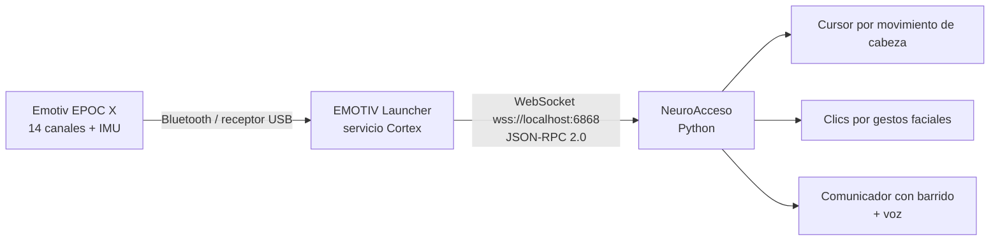

# NeuroAcceso 🧠🖱️

**Control del computador y comunicación manos libres con el casco EEG Emotiv EPOC X.**

Propuesta de proyecto de software · Universidad Católica de Cuenca · 2026

---

## 1. El problema

Las personas con movilidad reducida severa (lesión medular, ELA, parálisis cerebral, accidentes cerebrovasculares) a menudo no pueden usar un ratón ni un teclado, y en algunos casos tampoco pueden hablar. Las soluciones comerciales de accesibilidad (seguidores oculares, comunicadores dedicados) son caras y poco accesibles en nuestro medio.

## 2. La solución

**NeuroAcceso** es una aplicación de escritorio que usa el casco **Emotiv EPOC X** (que la universidad ya tiene) para que una persona pueda:

| Función | Cómo se controla |
|---|---|
| 🖱️ **Mover el cursor** | Girando la cabeza (giroscopio/IMU del casco) |
| 👆 **Clic izquierdo** | Apretando la mandíbula (*clench*) |
| 👉 **Clic derecho** | Guiño del ojo derecho |
| ⏸️ **Pausar / reanudar el cursor** | Guiño del ojo izquierdo |
| ⌨️ **Escribir** | Teclado en pantalla con barrido automático; se selecciona con un gesto |
| 🔊 **Hablar** | El texto escrito y las frases rápidas se leen en voz alta |
| 🧠 **Comando mental (fase avanzada)** | Comando "empujar" entrenado, como acción alternativa |

**Costo: $0.** Solo usa el casco existente, un PC y software gratuito.

## 3. ¿Por qué es factible?

- El EPOC X incluye **gratis la API básica de Emotiv (Cortex)**, que entrega en tiempo real:
  - **Expresiones faciales** (`fac`): parpadeo, guiños, mandíbula, sonrisa, cejas.
  - **Movimiento** (`mot`): acelerómetro, magnetómetro y giroscopio/cuaterniones.
  - **Comandos mentales** (`com`), **bandas de potencia** (`pow`) y **calidad de contacto** (`dev`).
- El **EEG crudo no es necesario** (es lo único que requiere licencia de pago).
- Las expresiones faciales y el movimiento son las detecciones **más fiables** del casco.
- Emotiv documenta este uso para comunicación de personas con discapacidad, y hay estudios que validan el uso de guiños para controlar dispositivos de asistencia (ver [referencias](#11-referencias)).

## 4. Cómo funciona



Detalle completo en [docs/arquitectura.md](docs/arquitectura.md) y [docs/cortex-api.md](docs/cortex-api.md).

## 5. Tecnologías

| Componente | Tecnología | Costo |
|---|---|---|
| Lenguaje | **Python 3.10+** | Gratis |
| Conexión con el casco | **Emotiv Cortex API** vía WebSocket (`websocket-client`) | Gratis (incluida con EPOC X) |
| Software de Emotiv | **EMOTIV Launcher** (+ EmotivBCI para entrenar) | Gratis |
| Control de ratón/teclado | `pyautogui` | Gratis |
| Interfaz gráfica | `tkinter` (incluido en Python) | Gratis |
| Texto a voz | `pyttsx3` (usa las voces de Windows, funciona sin internet) | Gratis |
| Configuración | `python-dotenv` | Gratis |
| Control de versiones | Git + GitHub | Gratis |
| Editor | VS Code | Gratis |

**Hardware:** Emotiv EPOC X (ya disponible), receptor USB o Bluetooth del PC, solución salina para los sensores, PC con Windows 10/11 o macOS.

## 6. Estructura del repositorio

```
neuroacceso/
├── README.md                  ← esta propuesta
├── requirements.txt           ← dependencias de Python
├── .env.example               ← plantilla de credenciales de Emotiv
├── docs/
│   ├── guia-inicio.md         ← paso a paso para dejar todo funcionando
│   ├── arquitectura.md        ← diseño del sistema y módulos
│   ├── cortex-api.md          ← resumen técnico de la API de Emotiv
│   ├── plan-de-trabajo.md     ← fases, tareas, roles y cronograma
│   └── riesgos.md             ← riesgos y cómo mitigarlos
├── scripts/
│   └── probar_conexion.py     ← prueba inicial: muestra los datos del casco
└── src/neuroacceso/
    ├── config.py              ← ajustes (sensibilidad, gestos, tiempos)
    ├── cortex_client.py       ← cliente de la API Cortex
    ├── head_mouse.py          ← cursor controlado con la cabeza
    ├── gestos.py              ← traduce expresiones faciales a acciones
    ├── comunicador.py         ← teclado con barrido + voz
    └── __main__.py            ← punto de entrada
```

## 7. Inicio rápido

> Guía detallada (cuenta de Emotiv, Client ID, colocación del casco): **[docs/guia-inicio.md](docs/guia-inicio.md)**

```bash
git clone https://github.com/SantiagoMarquez06/neuroacceso.git
cd neuroacceso
python -m venv .venv
.venv\Scripts\activate          # Windows  (macOS/Linux: source .venv/bin/activate)
pip install -e .                # instala dependencias y el paquete neuroacceso
copy .env.example .env          # y poner el Client ID / Secret de Emotiv

# 1) Probar que llegan datos del casco
python scripts/probar_conexion.py

# 2) Cursor manos libres
python -m neuroacceso --modo cursor

# 3) Comunicador (con --simular se usa la barra espaciadora en vez del casco)
python -m neuroacceso --modo comunicador
python -m neuroacceso --modo comunicador --simular
```

## 8. Plan de trabajo (resumen)

| Fase | Entregable | Duración estimada |
|---|---|---|
| 0. Preparación | Cuenta Emotiv, Client ID, prueba de conexión OK | 1 semana |
| 1. Cursor con la cabeza | Mover el ratón con el giro de la cabeza, calibración | 2 semanas |
| 2. Gestos → clics | Clics por mandíbula/guiños con anti-rebote | 1–2 semanas |
| 3. Comunicador | Teclado con barrido, frases rápidas, voz | 2–3 semanas |
| 4. Comando mental (opcional) | Entrenar "empujar" y usarlo como acción | 1–2 semanas |
| 5. Pruebas y presentación | Pruebas con usuarios, métricas, informe y demo | 2 semanas |

Detalle con tareas y roles: [docs/plan-de-trabajo.md](docs/plan-de-trabajo.md).

## 9. Cómo se medirá el éxito

- **Precisión de gestos:** % de gestos reconocidos correctamente y falsos positivos por minuto.
- **Velocidad de escritura:** caracteres por minuto en el comunicador.
- **Tarea de puntería:** tiempo para hacer clic en objetivos en pantalla (prueba tipo Fitts).
- **Usabilidad:** cuestionario SUS (System Usability Scale) aplicado a voluntarios.

## 10. Alcance y limitaciones

- No es un dispositivo médico; es un **prototipo académico**.
- No usa EEG crudo (requiere licencia de pago); se basa en las detecciones gratuitas de Cortex.
- Los comandos mentales requieren entrenamiento por usuario y son menos fiables que los gestos; por eso son opcionales.
- Ver [docs/riesgos.md](docs/riesgos.md).

## 11. Referencias

- Cortex API (oficial): https://emotiv.gitbook.io/cortex-api
- Ejemplos oficiales de Emotiv: https://github.com/Emotiv/cortex-example
- Emotiv y comunicación para personas con discapacidad: https://www.emotiv.com/knowledge-base/emotiv-disability-communication-tech
- Clasificación de guiños para dispositivos de asistencia (SN Applied Sciences, 2020): https://shdl.mmu.edu.my/7987/
- Validación del EPOC Flex para investigación EEG/ERP (PeerJ, 2020): https://peerj.com/articles/9713
- Proyecto similar con EPOC X (Grand Canyon University): https://aigcu.github.io/EEG-Game-Website/

## Licencia

MIT — ver [LICENSE](LICENSE).
