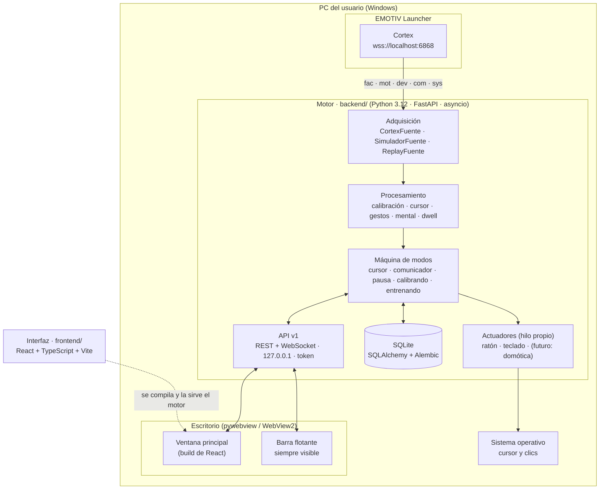
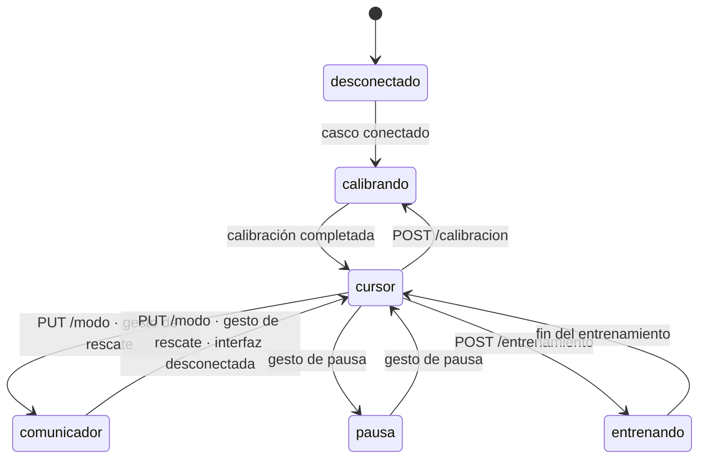

# Arquitectura del sistema — NeuroAcceso v1

> Este documento describe el **sistema real** que reemplaza al prototipo. La arquitectura del prototipo (tkinter) está en [arquitectura.md](arquitectura.md) y su código se mantiene como referencia hasta que el nuevo backend lo reemplace. División del trabajo: [division-del-trabajo.md](division-del-trabajo.md).

## 1. Objetivos de diseño

| Objetivo | Decisión |
|---|---|
| **Escalable** (nuevas pantallas, nuevos dispositivos de entrada, nuevas acciones, otros clientes) | Motor y la interfaz separados por una **API versionada**; capas con interfaces (`Fuente`, `Detector`, `Actuador`). |
| **Tiempo real** (el cursor debe sentirse inmediato) | El camino casco → cursor vive entero en el motor, en asyncio + un hilo de actuadores; objetivo **< 30 ms**. |
| **Seguro** aunque sea local (controla ratón y teclado) | Token por arranque, validación de Origin/Host, credenciales en el almacén del SO. |
| **Accesible** | La interfaz debe poder usarse con el propio casco: barrido, objetivos grandes, alto contraste, voz sin internet. |
| **Probable sin casco** | Fuentes intercambiables: Cortex real, simulador y reproducción de grabaciones. |
| **Costo $0** | Solo streams gratuitos de Cortex y software libre. |

## 2. Vista general



## 3. Motor (`backend/`) — Parte A

### 3.1 Estructura propuesta
```
backend/
├── pyproject.toml
├── src/neuroacceso_motor/
│   ├── main.py              ← arranque: FastAPI + pywebview + token
│   ├── config.py            ← ajustes del servicio (puerto, rutas, modo demo)
│   ├── fuentes/             ← base.py (Fuente), cortex.py, simulador.py, replay.py, grabador.py
│   ├── procesamiento/       ← calibracion.py, cursor.py, gestos.py, mental.py, dwell.py
│   ├── modos.py             ← máquina de estados + gesto de rescate
│   ├── actuadores/          ← base.py (Actuador), raton.py, teclado.py
│   ├── dominio/             ← modelos y lógica (perfiles, ajustes, sesiones, métricas Fitts)
│   ├── persistencia/        ← SQLAlchemy, repositorios, migraciones Alembic
│   ├── api/                 ← rest/*.py, ws.py (hub de eventos), seguridad.py
│   └── escritorio/          ← ventana principal y barra flotante (pywebview)
├── grabaciones/             ← sesiones reales del casco (JSONL) para Replay y tests
└── tests/                   ← unitarios, contrato, replay, latencia
```

### 3.2 Flujo de una muestra
1. La **Fuente** entrega muestras normalizadas (`MuestraMovimiento`, `MuestraFacial`, `MuestraDispositivo`, `MuestraMental`), con la hora original de Cortex.
2. **Procesamiento** las convierte en señales (`Orientacion`, `Gesto`, `Permanencia`) según los **ajustes del perfil activo**.
3. La **máquina de modos** decide qué significa cada señal **en el modo actual**:
   - en `cursor`: mover el ratón o hacer clic → **Actuador**;
   - en `comunicador`: emitir `entrada{seleccionar}` para la interfaz, sin tocar el ratón;
   - en `pausa`: ignorar todo salvo el gesto de reanudar o de rescate.
4. Todo se publica en el **hub WebSocket** (con descarte de eventos de alta frecuencia si un cliente va lento) y lo relevante se guarda en **SQLite** fuera del camino crítico.

### 3.3 Máquina de modos

Reglas:
- **El modo lo decide el motor.** La interfaz solo lo pide (`PUT /modo`) y se entera por el evento `modo`.
- **Gesto de rescate** (configurable, p. ej. doble guiño): cambia entre cursor y comunicador desde cualquier estado. El usuario nunca queda atrapado.
- Si la interfaz se desconecta estando en `comunicador`, el motor vuelve a `cursor` y lo avisa en la barra flotante.

### 3.4 Concurrencia y latencia
- asyncio para red (Cortex, API). Los actuadores (`SendInput` / pyautogui) corren en **un hilo dedicado con cola**, para no bloquear el bucle ni desordenar movimientos.
- Escrituras a la base de datos en lote y fuera del camino `mot → cursor`.
- Presupuesto: **< 30 ms** desde la marca de tiempo de Cortex hasta el movimiento. El motor publica p50/p95 en `/estado` y un test con ReplayFuente falla si se supera.
- Windows: el proceso declara **DPI awareness** al arrancar; `SendInput` no puede actuar sobre ventanas elevadas (UAC, Administrador de tareas): limitación conocida.

### 3.5 Seguridad
Escuchar en `127.0.0.1` **no basta**: cualquier página web abierta en el navegador puede conectarse a un WebSocket local (los WebSocket no aplican CORS) y mover el ratón.
1. **Token aleatorio por arranque**, obligatorio en REST (`Authorization: Bearer`) y WebSocket (`?token=`). pywebview lo inyecta en la ventana.
2. Validación de **`Origin`** (WebSocket) y **`Host`** (todas las peticiones) contra una lista blanca.
3. CORS cerrado; en desarrollo solo se permite el origen del servidor de Vite.
4. El **Client Secret** de Cortex nunca sale por la API; se guarda con `keyring` (Administrador de credenciales de Windows).
5. Los endpoints `/dev/*` solo existen en modo `--demo`.

### 3.6 Datos
| Entidad | Contenido |
|---|---|
| `Perfil` | nombre, perfil de Cortex asociado (el entrenamiento vive en la nube de Emotiv; no se duplica) |
| `Ajustes` | cursor, gestos y mapeo por modo, gesto de rescate, dwell, comunicador, voz (JSON versionado por perfil) |
| `Sesion` | tipo (libre / práctica / comunicador), inicio, fin, métricas |
| `Intento` | objetivo, origen, clic, tiempos, acierto (los mide la interfaz) |
| `Enunciado` | texto escrito en el comunicador, duración, selecciones, correcciones |
| `EventoRegistro` | gestos/acciones con marca de tiempo para calcular falsos positivos |

Las **métricas** (throughput de Fitts según ISO 9241-411, precisión, falsos positivos/min, caracteres/min) las calcula el motor a partir de los datos crudos, para poder probarlas con pytest y reutilizarlas en informes.

## 4. Interfaz (`frontend/`) — Parte B

### 4.1 Tecnologías
| Necesidad | Elección |
|---|---|
| Base | React 18 + TypeScript + Vite |
| Estado de servidor / caché | TanStack Query |
| Estado local (modo, conexión, último gesto) | Zustand, alimentado por el WebSocket |
| Tipos de la API | Generados desde `contrato/` (`openapi-typescript`, `json-schema-to-typescript`) |
| Mocks | MSW con los ejemplos de `contrato/ejemplos/` |
| Voz | Web Speech API filtrando `voice.localService` y `lang` español (sin internet) |
| Pruebas | Vitest + Testing Library; Playwright para flujos |
| Gráficas | Recharts (informes) |

### 4.2 Estructura propuesta
```
frontend/src/
├── api/            ← cliente REST tipado, cliente WS con reconexión, tipos generados
├── estado/         ← stores (conexión, modo, dispositivo, perfil)
├── componentes/    ← sistema accesible: BotonGrande, Tarjeta, Indicador, MapaSensores…
├── barrido/        ← motor de barrido reutilizable (hook puro, probado)
├── pantallas/
│   ├── estado/  onboarding/  ajustes/  perfiles/
│   ├── comunicador/  entrenamiento/  practica/  historial/
│   └── barra-flotante/
├── prediccion/     ← predicción de palabras (frecuencias + historial)
└── mocks/          ← handlers MSW
```

### 4.3 Reglas de diseño
- **La interfaz nunca mueve el cursor.** Recibe clics como cualquier aplicación (los genera el motor). Por eso la práctica de puntería mide los aciertos con eventos del DOM.
- Todas las pantallas principales deben poder usarse **solo con el casco**: objetivos ≥ 64 px, sin menús al pasar el ratón, navegación por barrido.
- Contraste mínimo WCAG AA; modo de alto contraste.
- La barra flotante es una ruta propia (`/barra`) que el motor abre en una ventana pequeña siempre visible.

## 5. Contrato
Ver [contrato/api-v1.md](../contrato/api-v1.md). Resumen:
- REST en `http://127.0.0.1:{puerto}/api/v1` para **órdenes y datos** (perfiles, ajustes, modo, calibración, sesiones).
- WebSocket en `/api/v1/eventos` solo de **servidor a cliente** para el tiempo real; sobre común `{v, tipo, seq, t, datos}`; al reconectar llega `hola` con el estado completo.

## 6. Escritorio y empaquetado
- **pywebview** (WebView2, incluido en Windows 10/11) abre la ventana principal y la barra flotante. FastAPI sirve el build de Vite como estáticos.
- En desarrollo: Jonnathan usa `npm run dev` en el navegador; Santiago corre el motor con `--demo`.
- **PyInstaller `--onedir`** (no `--onefile`, que provoca falsos positivos del antivirus). Primer ejecutable en la semana 6; sin firma de código (SmartScreen avisará: documentado).

## 7. Qué se reutiliza del prototipo
| Prototipo (`src/neuroacceso/`) | Destino |
|---|---|
| `cortex_client.py` | Base de `fuentes/cortex.py` (pasar a asyncio, añadir perfiles y entrenamiento) |
| `head_mouse.py` | `procesamiento/cursor.py` (leer de `Ajustes` del perfil, no de `config` global) |
| `gestos.py` | `procesamiento/gestos.py` (mapeo por modo, gesto de rescate) |
| `simulador.py` (`EstadoCasco`, servidor falso) | `fuentes/simulador.py` dentro del proceso; el servidor falso queda para probar `CortexFuente` |
| `app.py` (lógica de modos y práctica) | Modos → `modos.py`; métricas → `dominio/metricas.py`; pantallas → frontend |
| `comunicador.py` | Lógica de barrido → `frontend/src/barrido/` |
| `tests/` | Base de los tests del motor |

## 8. Cómo escala después
- **Nuevas entradas** (otro casco, cámara, pulsador): una nueva `Fuente` o `Detector`; el resto no cambia.
- **Nuevas acciones** (domótica, control de un juego): un nuevo `Actuador` y una acción más en el enum del contrato.
- **Tablet del cuidador / monitoreo remoto**: otro cliente de la misma API; requerirá emparejamiento (QR) y TLS — el token ya deja el camino preparado.
- **Más idiomas**: textos de la interfaz centralizados para i18n.
- **Investigación**: las grabaciones JSONL y las métricas por sesión sirven como datos para tesis futuras.
