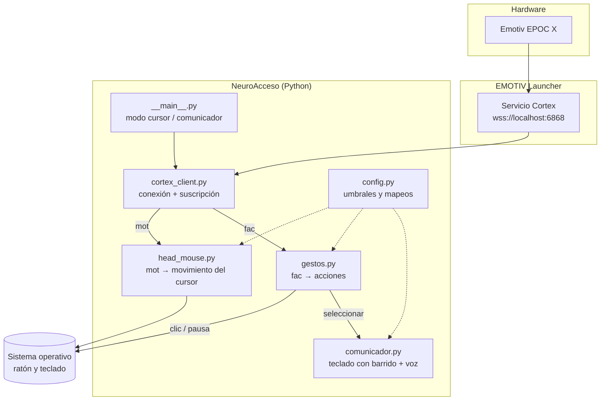

# Arquitectura

## Visión general

## Módulos

### `cortex_client.py`
- Abre el WebSocket con Cortex en un hilo aparte.
- Implementa llamadas JSON-RPC síncronas (`call(method, params)`) con espera de respuesta por `id`.
- `iniciar(streams)` hace toda la secuencia: `requestAccess → authorize → queryHeadsets → controlDevice → createSession → subscribe`.
- Guarda las columnas (`cols`) de cada stream y entrega cada muestra al callback registrado como un `dict` (`{"eyeAct": "winkL", ...}`).

### `head_mouse.py`
- Recibe muestras `mot`.
- **Calibración:** durante los primeros ~2 s el usuario mira al frente; se toma esa posición como "centro".
- Con **cuaterniones** calcula *yaw* (giro izquierda/derecha) y *pitch* (arriba/abajo) y mueve el cursor según el cambio entre muestras.
- Con **giroscopio** usa la velocidad angular menos el sesgo calibrado.
- Aplica **zona muerta** (ignora micro-movimientos) y **ganancia** (sensibilidad), configurables.

### `gestos.py`
- Recibe muestras `fac` y las convierte en acciones según `config.MAPEO_GESTOS`.
- **Umbral de potencia** para gestos con intensidad (`clench`, `smile`…).
- **Anti-rebote (cooldown):** tras una acción, ignora gestos durante `COOLDOWN_S` segundos para evitar dobles clics.
- Emite acciones abstractas (`clic`, `clic_derecho`, `pausar`, `seleccionar`) que consumen el modo cursor o el comunicador.

### `comunicador.py`
- Ventana `tkinter` con filas de letras, espacio, borrar, hablar y **frases rápidas**.
- **Barrido:** se resalta una fila cada `TIEMPO_BARRIDO_S`; con `seleccionar` se entra en la fila y se barren sus teclas; otro `seleccionar` escribe la tecla.
- **Voz:** `pyttsx3` (voces del sistema, sin internet).
- **Modo simulación:** la barra espaciadora reemplaza al gesto, para desarrollar sin el casco.

### `config.py`
Todos los parámetros ajustables en un solo sitio: sensibilidad, zona muerta, umbrales, mapeo de gestos, tiempos de barrido, frases rápidas.

## Hilos y concurrencia

- Cortex entrega datos en el hilo del WebSocket.
- En modo **cursor**, las acciones se ejecutan directamente (`pyautogui`).
- En modo **comunicador**, `tkinter` debe actualizarse desde su hilo: las acciones se pasan por una `queue.Queue` que la ventana revisa cada 50 ms.

## Decisiones de diseño

| Decisión | Motivo |
|---|---|
| Python | Curva de aprendizaje baja, ejemplos oficiales de Emotiv en Python, librerías de accesibilidad disponibles. |
| Gestos faciales + IMU como entrada principal | Son las detecciones más fiables y no requieren licencia. |
| Comandos mentales como opcionales | Requieren entrenamiento por usuario y tienen más errores. |
| Barrido por filas/columnas | Técnica estándar en comunicadores alternativos; funciona con una sola señal de "seleccionar". |
| Sin EEG crudo | Requiere licencia de pago; el proyecto debe costar $0. |
