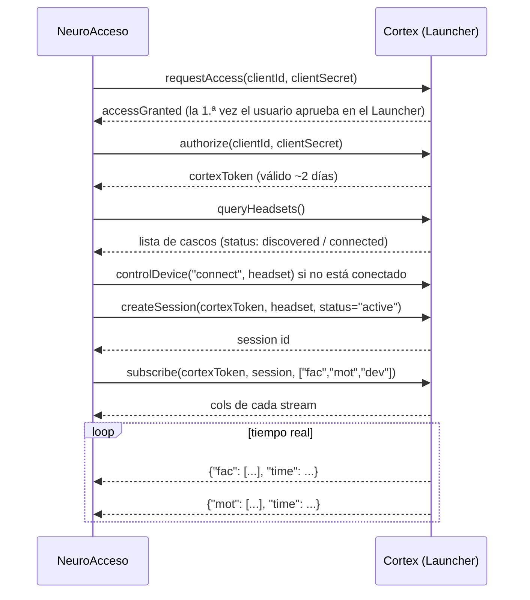

# Resumen técnico de la Cortex API

Fuente oficial: https://emotiv.gitbook.io/cortex-api — este documento resume lo que usa NeuroAcceso.

## Conexión

- **Transporte:** WebSocket seguro en `wss://localhost:6868` (lo abre el servicio Cortex del EMOTIV Launcher).
- **Protocolo:** JSON-RPC 2.0. Cada petición lleva `id`, `method` y `params`.

```json
{"jsonrpc": "2.0", "id": 1, "method": "requestAccess",
 "params": {"clientId": "...", "clientSecret": "..."}}
```

## Secuencia de llamadas



## Streams disponibles

| Stream | Contenido | ¿Gratis con EPOC X? | Uso en NeuroAcceso |
|---|---|---|---|
| `fac` | Expresiones faciales | ✅ | Clics y selección |
| `mot` | Movimiento (IMU) | ✅ | Cursor |
| `dev` | Batería y calidad de contacto | ✅ | Indicador de estado |
| `com` | Comandos mentales | ✅ | Fase 4 (opcional) |
| `pow` | Potencia por bandas por canal | ✅ | No (posible extensión) |
| `met` | Métricas (atención, estrés…) | ⚠️ baja resolución | No |
| `eeg` | EEG crudo | ❌ licencia de pago | No |

### `fac` — expresiones faciales
Columnas: `["eyeAct", "uAct", "uPow", "lAct", "lPow"]`

- `eyeAct`: acción de los ojos (ej. `blink`, `winkL`, `winkR`, `lookL`, `lookR`, `neutral`).
- `uAct` / `uPow`: acción de la cara superior (ej. `surprise`, `frown`) y su intensidad 0–1.
- `lAct` / `lPow`: acción de la cara inferior (ej. `clench`, `smile`, `laugh`, `smirkLeft`, `smirkRight`) y su intensidad 0–1.

Ejemplo: `"fac": ["neutral", "neutral", 0, "clench", 0.0576]`

> La lista exacta de acciones se obtiene con el método `getDetectionInfo` (`detection: "facialExpression"`). Verificarla con el casco real.

### `mot` — movimiento
Columnas: `COUNTER_MEMS, INTERPOLATED_MEMS`, luego **o bien** `Q0, Q1, Q2, Q3` (cuaterniones, cascos nuevos) **o bien** `GYROX, GYROY, GYROZ` (cascos antiguos), y `ACCX, ACCY, ACCZ, MAGX, MAGY, MAGZ`.

`head_mouse.py` soporta ambos formatos: siempre se leen los nombres de `cols` que devuelve `subscribe`.

### `dev` — estado del casco
Columnas: `["Battery", "Signal", [AF3, F7, F3, FC5, T7, P7, O1, O2, P8, T8, FC6, F4, F8, AF4, "OVERALL"], "BatteryPercent"]`

- Calidad por sensor: 0 (sin contacto) a 4 (excelente). `OVERALL`: 0–100.

### `com` — comandos mentales
Columnas: `["act", "pow"]` → acción (`neutral`, `push`, …) e intensidad 0–1.

## Notas importantes

- **No se puede abrir sesión** con el casco conectado por el **cable USB** (de carga).
- La app debe ser **aprobada una vez** en el EMOTIV Launcher (`requestAccess`).
- Se deben leer siempre las columnas (`cols`) que devuelve `subscribe`; el orden puede variar según el casco y la versión.
- Errores típicos: `-32016` = stream no disponible (p. ej. `eeg` sin licencia).
