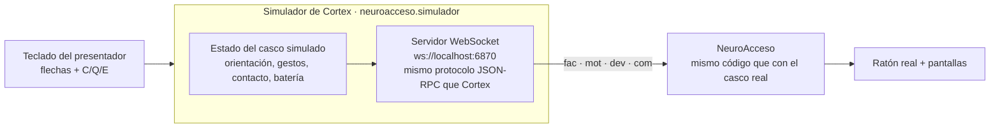
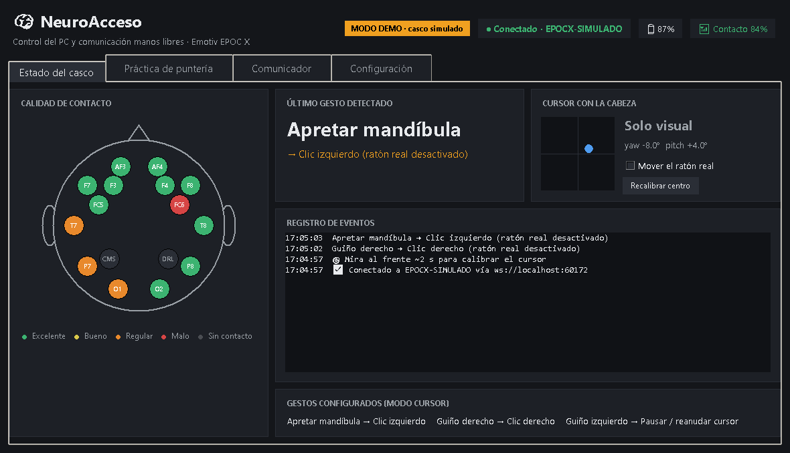
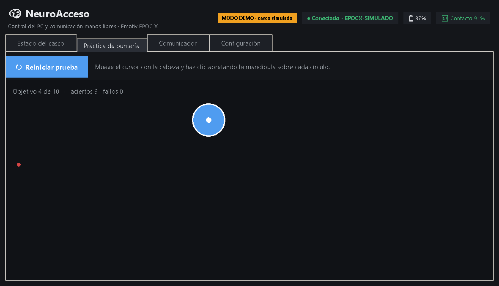
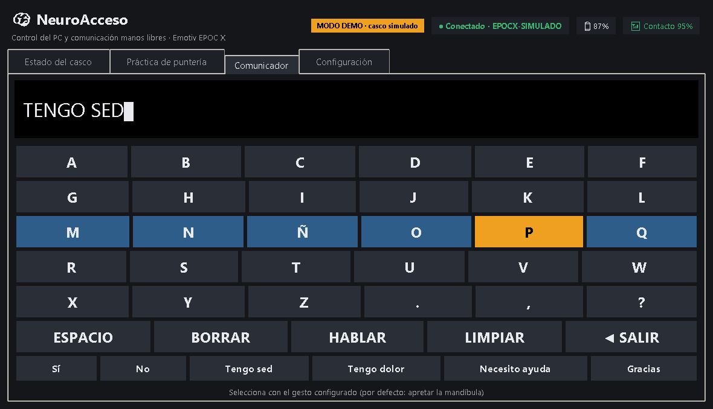
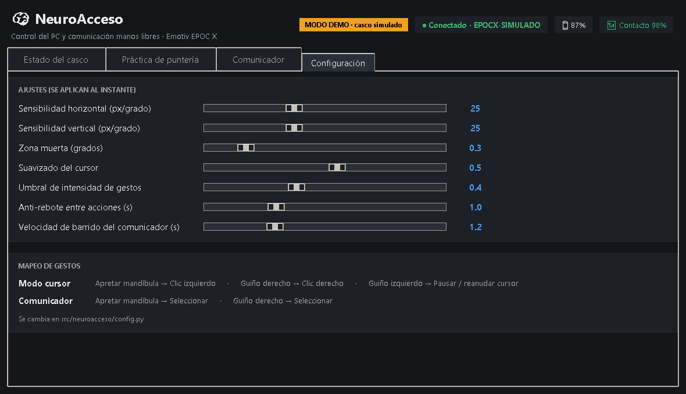
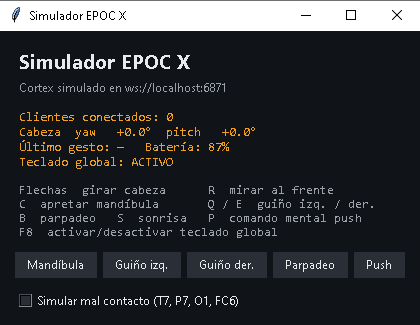

# Demo sin casco

La demo permite mostrar **todas las funciones de NeuroAcceso sin el Emotiv EPOC X** y sin credenciales. Sirve para presentar la propuesta y para que el equipo programe aunque solo haya un casco.

## Cómo funciona



El simulador **imita el servicio Cortex del EMOTIV Launcher**: responde a `requestAccess`, `authorize`, `queryHeadsets`, `createSession`, `subscribe`, `getDetectionInfo`, etc., y emite los streams con los mismos nombres de columnas que el casco real. Así **la aplicación no sabe que es una simulación**: el código que se demuestra es exactamente el que se usará con el EPOC X; solo cambia la URL (`ws://localhost:6870` en vez de `wss://localhost:6868`).

## Arrancar

```bash
pip install -e ".[demo]"
python -m neuroacceso --demo
```

Se abren dos ventanas:

| Ventana | Qué es |
|---|---|
| **Simulador EPOC X** (pequeña) | Hace de "casco": muestra la orientación simulada, el último gesto y los controles. |
| **NeuroAcceso** | La aplicación real, conectada al casco simulado. |

### Controles del simulador

Funcionan aunque la ventana activa sea otra (teclado global, **F8** lo activa/desactiva):

| Tecla | Simula |
|---|---|
| ← → ↑ ↓ | Girar la cabeza (mueve el cursor) |
| **C** | Apretar la mandíbula → clic / seleccionar |
| **E** | Guiño derecho → clic derecho / seleccionar |
| **Q** | Guiño izquierdo → pausar / reanudar el cursor |
| B / S | Parpadeo / sonrisa (no tienen acción: muestran que se ignoran) |
| P | Comando mental *push* |
| R | Volver a mirar al frente |

También hay botones y una casilla **"Simular mal contacto"**, que pone en rojo algunos sensores del mapa.

> Opción `--sin-raton`: la app muestra todo pero **no mueve el ratón real** (útil si se presenta desde un PC ajeno).

## Guion sugerido para presentar (5 minutos)

1. **Estado del casco.** Mostrar el mapa de sensores en verde, batería y "Conectado". Marcar *Simular mal contacto* → los sensores T7, P7, O1 y FC6 se ponen rojos y baja el % de contacto. Explicar que así se verifica la colocación antes de usarlo.
2. **Cursor con la cabeza.** Pulsar las flechas: el punto azul de orientación y el **ratón real** se mueven. Pulsar **Q** → "Cursor en pausa"; otra vez **Q** → reanudado.
3. **Clics por gestos.** Pulsar **C** sobre cualquier cosa → clic. El registro de eventos muestra *Apretar mandíbula → Clic izquierdo*. Pulsar **B** (parpadeo) → se detecta pero no hace nada: el parpadeo natural no debe provocar clics.
4. **Práctica de puntería.** Abrir la pestaña (con la cabeza + **C**), *Iniciar prueba* y alcanzar los 10 círculos. Al final se muestran tiempo medio, precisión y objetivos por minuto: son las **métricas de evaluación** del proyecto.
5. **Comunicador.** Abrir la pestaña: el cursor se bloquea y empieza el barrido. Con **C** se elige fila y luego letra. Escribir "HOLA" y elegir **HABLAR** (se escucha en voz alta), o usar una frase rápida como "Tengo sed". **◀ SALIR** vuelve al estado.
6. **Configuración.** Mover los deslizadores (sensibilidad, umbral, anti-rebote, velocidad de barrido) y mostrar que el efecto es inmediato.
7. **Cierre.** Explicar que con el casco real solo cambia el comando: `python -m neuroacceso`.

## Capturas

| Estado del casco | Práctica de puntería |
|---|---|
|  |  |
| **Comunicador** | **Configuración** |
|  |  |

Panel del simulador:



## Métodos extra del simulador

Además del protocolo de Cortex, el simulador acepta tres métodos para pruebas automáticas o demos con guion:

| Método | Parámetros | Efecto |
|---|---|---|
| `simularGesto` | `{"gesto": "clench"}` | Dispara un gesto (`clench`, `winkL`, `winkR`, `blink`, `smile`, `push`, …) |
| `simularCabeza` | `{"yaw": 10, "pitch": -5}` | Fija la orientación de la cabeza (grados) |
| `simularContacto` | `{"malo": true}` | Activa/desactiva el mal contacto |

Las pruebas (`python -m pytest -q`) los usan para verificar el flujo completo **cliente → Cortex simulado → gestos → acciones**.
