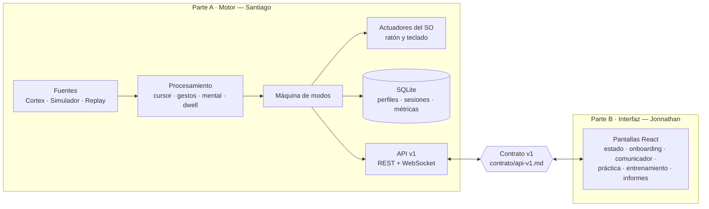

# División del trabajo — NeuroAcceso v1

| | |
|---|---|
| **Parte A — Motor (backend)** | **Santiago** · [@SantiagoMarquez06](https://github.com/SantiagoMarquez06) |
| **Parte B — Interfaz (frontend)** | **Jonnathan** · [@jonnathanguaman](https://github.com/jonnathanguaman) |
| **Duración** | 12 semanas · semana 1 = lunes 16 de noviembre de 2026 |
| **Arquitectura** | [arquitectura-sistema.md](arquitectura-sistema.md) |
| **Contrato entre las partes** | [../contrato/api-v1.md](../contrato/api-v1.md) |

---

## 1. Idea central: dos partes que no se esperan

El sistema se parte por la línea más natural y estable: **quien habla con el casco y con el sistema operativo** (motor) y **quien habla con la persona** (interfaz). Entre las dos hay un **contrato** (API REST + eventos WebSocket) que se fija la primera semana.

**Por qué funcionan en paralelo:**

| Riesgo de bloqueo | Cómo se evita |
|---|---|
| Jonnathan necesita datos del casco para hacer pantallas | Usa **mocks** construidos con los ejemplos del contrato (semanas 2–3) y después el **backend en modo `--demo`** con el casco simulado (desde la semana 3). Nunca depende del casco real ni de código a medio hacer. |
| Santiago necesita una interfaz para probar el motor | Lo prueba con **tests automáticos** contra el contrato y con **grabaciones reales** del casco (ReplayFuente), sin ninguna pantalla. |
| Alguien cambia la API y rompe al otro | El contrato vive en `contrato/` y solo cambia por **PR aprobado por los dos**. El motor puede **añadir** campos opcionales sin romper; la interfaz ignora lo que no conoce. |
| Hay un solo casco | **Turnos fijos** por semana. Toda sesión con el casco se **graba** (JSONL) y queda en el repo para que el otro la reproduzca. |
| Integrar al final y descubrir que nada encaja | **Tres puntos de integración** (semanas 4, 7 y 11) con criterio de éxito concreto. |

---

## 2. Responsabilidades

### Parte A — Motor (Santiago)
Todo lo que corre en el **servicio Python local** (`backend/`):
- Conexión con Emotiv Cortex (perfiles, entrenamiento, reconexión) y las fuentes alternativas (simulador, reproducción de grabaciones).
- Procesamiento en tiempo real: calibración, cursor con la cabeza, detección de gestos, comando mental, clic por permanencia.
- **Máquina de modos** (cursor / comunicador / pausa / calibrando / entrenando) y gesto de rescate. **El modo lo decide el motor**, no la interfaz.
- Mover el ratón y hacer clics en el sistema operativo.
- Base de datos (perfiles, ajustes, sesiones, intentos, métricas) y cálculo de métricas (Fitts, falsos positivos).
- API v1 (REST + WebSocket), seguridad local (token, Origin), ventana de escritorio (pywebview) y empaquetado (PyInstaller).

### Parte B — Interfaz (Jonnathan)
Todo lo que **ve y usa la persona** (`frontend/`):
- Proyecto React + TypeScript + Vite, sistema de componentes **accesible** (alto contraste, botones ≥ 64 px, todo usable por barrido con el casco).
- Cliente tipado de la API y cliente WebSocket con reconexión.
- Pantallas: Estado del casco, Onboarding y calibración, Ajustes y Perfiles, **Comunicador** (barrido, predicción de palabras en español, frases, voz), Entrenamiento, **Práctica de puntería** (mide los intentos), Historial e informes, contenido de la barra flotante.

### Conjunto
- Contrato v1 (semana 1) y sus cambios.
- Pruebas con el casco real en los puntos de integración.
- Pruebas con usuarios, informe final y presentación.

**Carga estimada:** ~50/50. El motor pesa más en concurrencia e integración con Cortex; la interfaz, en número de pantallas y en accesibilidad.

---

## 3. Plan por fases

Cada tarea es un **issue** en GitHub con su etiqueta (`parte-A-motor` / `parte-B-interfaz` / `conjunto`) y su milestone (F0–F5).

### F0 · Semana 1 (16–22 nov) — Base y contrato
| Santiago | Jonnathan |
|---|---|
| Reorganizar el repo en monorepo (`backend/`, `frontend/`, `contrato/`, `legacy/` con el prototipo) | Crear `frontend/` con Vite + React + TS + ESLint + Prettier + Vitest |
| CI en GitHub Actions: pytest, ruff, mypy | CI del frontend: lint, typecheck, tests, build |
| FastAPI con `/api/v1/salud`, token por arranque y validación de Origin/Host | Design tokens accesibles (colores, tipografía, tamaños, modo alto contraste) |
| Interfaz `Fuente` (abstracción de la fuente de datos) | Generación de tipos TS desde el contrato + cliente WS con reconexión y token |

**Conjunta (2–3 días, primero de todo):** revisar y **congelar el contrato v1** (pasar el borrador a `openapi.yaml` + JSON Schema de eventos + `contrato/ejemplos/*.json`).
**Terminado cuando:** los dos CI pasan en verde y el contrato v1 está etiquetado como `contrato-v1.0`.

### F1 · Semanas 2–4 (23 nov – 13 dic) — Cortes verticales
| Santiago | Jonnathan |
|---|---|
| CortexFuente asíncrona (portar `cortex_client.py` a asyncio) | Estructura de la app: rutas, layout, barra de estado, manejo de errores |
| SimuladorFuente dentro del proceso + endpoints `/dev/simular/*` | Biblioteca de componentes accesibles (botón grande, tarjeta, indicador, lista de eventos) |
| Grabación de sesiones en JSONL + ReplayFuente | **Pantalla Estado del casco** (mapa de 14 sensores, batería, conexión, orientación, último gesto, registro) |
| Portar cursor con la cabeza y detector de gestos; hilo dedicado de actuadores | Panel de desarrollo que dispara `/dev/simular/*` |
| Hub WebSocket (`hola`, `conexion`, `dispositivo`, `orientacion`, `gesto`, `accion`) y modo `--demo` | Mocks MSW a partir de `contrato/ejemplos/` |

**Punto de integración 1 (semana 4):** con el **casco real**, la pantalla Estado muestra los datos en vivo y el cursor se mueve con la cabeza.

### F2 · Semanas 5–7 (14 dic – 3 ene) — Perfiles, modos y comunicador
| Santiago | Jonnathan |
|---|---|
| SQLite + SQLAlchemy + Alembic (perfiles, ajustes, sesiones, intentos) | Asistente de **onboarding y calibración** (guiado por eventos `calibracion`) |
| REST de perfiles y ajustes, aplicados en caliente | Pantallas de **Ajustes** y **Perfiles** |
| **Máquina de modos**, gesto de rescate, vuelta a cursor si la interfaz se cae | **Comunicador**: motor de barrido (hook puro con tests), teclado, frases rápidas editables |
| Calibración como proceso con progreso; clic por permanencia (dwell) | Voz con Web Speech API usando **voces locales** del SO (sin internet) |
| Ventana pywebview + **barra flotante siempre visible**; **1.er ejecutable** PyInstaller (semana 6) | Contenido de la barra flotante (modo, pausa, último gesto, batería) |

**Punto de integración 2 (semana 7):** desde el **ejecutable**, escribir y decir en voz alta una frase usando solo gestos.

### F3 · Semanas 8–9 (4 – 17 ene) — Entrenamiento y métricas
| Santiago | Jonnathan |
|---|---|
| Entrenamiento con Cortex (perfiles, `training` start/accept/reject) — contrato v1.1 | Pantalla de **Entrenamiento** (cuenta atrás, estímulo, aceptar/rechazar) |
| Stream de comando mental (`com`) con umbral, como acción alternativa | **Práctica de puntería** (secuencia ISO 9241-411, envío de intentos) |
| Sesiones, intentos, **cálculo de Fitts** y `/metricas`; medición de latencia | **Predicción de palabras** en español (frecuencias + historial del usuario) |
| Voz de respaldo en el backend (SAPI) | Integración de las métricas en la práctica (resultados al terminar) |

### F4 · Semanas 10–11 (18 – 31 ene) — Endurecer
| Santiago | Jonnathan |
|---|---|
| Pruebas con grabaciones reales (Replay); presupuesto de latencia < 30 ms | **Historial e informes** de sesiones (gráficas, exportar) |
| Errores de Cortex: token expirado, casco caído, reconexión automática | **Auditoría de accesibilidad** (contraste, foco, uso solo por barrido) |
| Atajos de teclado de emergencia; instalador | Estados vacíos, de carga y de error; revisión de textos |

**Punto de integración 3 (semana 11):** versión candidata probada por los dos con el casco.

### F5 · Semana 12 (1 – 7 feb) — Cierre
| Santiago | Jonnathan |
|---|---|
| Protocolo de pruebas con usuarios; exportar métricas a CSV | Video demo, capturas, encuesta SUS |

**Conjunta:** pruebas con 5–10 voluntarios (con consentimiento), informe final y presentación.

> Las semanas 6 y 7 coinciden con Navidad y Año Nuevo: si hace falta, F2 se extiende una semana y F4 absorbe el retraso.

---

## 4. Forma de trabajo

### Git
- `main` siempre funciona y está **protegida**: solo entra por Pull Request.
- Ramas: `motor/<tarea>` (Santiago), `interfaz/<tarea>` (Jonnathan), `contrato/<cambio>` (los dos).
- Cada PR enlaza su issue (`Closes #N`) y debe pasar el CI.
- **CODEOWNERS** (`.github/CODEOWNERS`): `backend/` lo aprueba Santiago, `frontend/` Jonnathan, `contrato/` los dos. Para que GitHub exija esas aprobaciones en un repo privado hace falta GitHub Pro, gratis con el [Student Developer Pack](https://education.github.com/pack). Mientras tanto se respeta como acuerdo.

### Contrato
- Un cambio en `contrato/` = PR propio, aprobado por los dos, **antes** de implementarlo.
- Compatibilidad: **añadir** campos opcionales está permitido; **quitar o renombrar** obliga a subir de versión (`/api/v2`).
- Los ejemplos de `contrato/ejemplos/` son la fuente común: alimentan los mocks de Jonnathan y los tests de Santiago.

### Casco
- Turnos fijos semanales (a acordar), por ejemplo: Santiago lunes y miércoles, Jonnathan martes y jueves, viernes conjunto.
- Toda sesión con el casco se graba (`backend/grabaciones/*.jsonl`) para que el otro pueda reproducirla.

### Sincronización
- 15 minutos dos veces por semana: qué hice, qué haré, qué me bloquea.
- El tablero de issues y los milestones son la referencia del avance.

---

## 5. Criterio de "terminado" (para cada tarea)
1. El código está en `main` por PR revisado.
2. Tiene tests (pytest / Vitest) y el CI pasa.
3. Cumple el contrato (los tests del motor validan los eventos contra el esquema; la interfaz usa los tipos generados).
4. Si es de interfaz: se puede usar **solo con el casco** (barrido / cursor + gesto) y cumple el contraste mínimo.
5. Está documentado si cambia el uso (README o `docs/`).

---

## 6. Riesgos de la división

| Riesgo | Mitigación |
|---|---|
| El contrato v1 resulta incompleto | Cambios por PR rápido; campos opcionales; v1.1 ya reservada para entrenamiento. |
| Una parte va más rápido que la otra | Las tareas de cada fase son independientes; quien adelanta toma tareas de la siguiente fase de **su** parte, no de la del otro. |
| Integración tardía | Puntos de integración 1, 2 y 3 obligatorios, con el casco real. |
| Un solo casco | Turnos + grabaciones + simulador. |
| Vacaciones de fin de año | Holgura en F4; las fechas de F2 pueden moverse una semana. |
