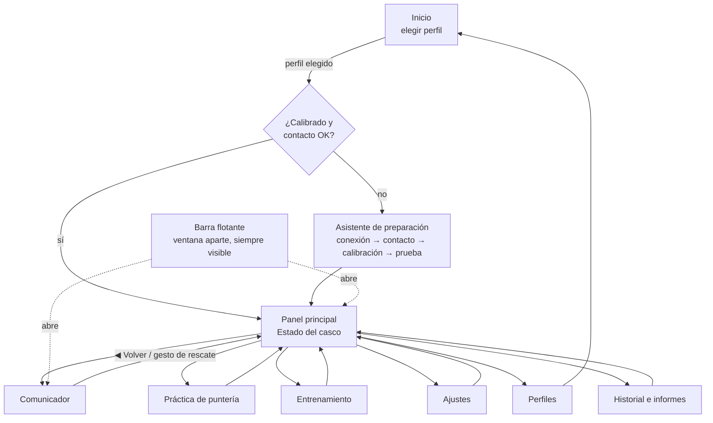
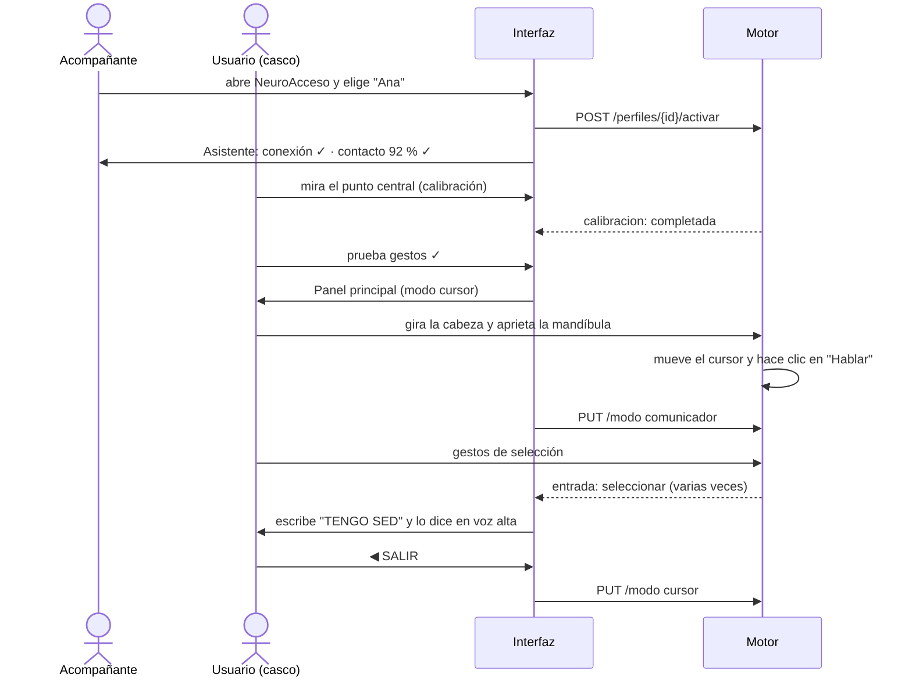

# Especificación de pantallas — NeuroAcceso v1

> Guía para construir la **interfaz** (Parte B · Jonnathan). Describe qué pantallas hay, qué lleva cada una, qué datos usa del motor y cómo se usa **solo con el casco**.
> Datos y endpoints: [contrato/api-v1.md](../contrato/api-v1.md) · Arquitectura: [arquitectura-sistema.md](arquitectura-sistema.md) · Tareas: [division-del-trabajo.md](division-del-trabajo.md)
>
> Los bocetos son orientativos: muestran **qué** va y su prioridad, no el diseño final. El diseño visual lo decide Jonnathan respetando los principios de la sección 1.

---

## 0. ¿Quién usa la aplicación?

| Persona | Qué necesita | Cómo interactúa |
|---|---|---|
| **Usuario principal** — persona con movilidad reducida severa (puede no hablar) | Usar el PC y comunicarse | **Solo con el casco**: cabeza (cursor), gestos (clic / seleccionar), barrido |
| **Acompañante** — familiar, terapeuta, estudiante que prepara la sesión | Poner el casco, crear perfiles, ajustar, ver progreso | Ratón y teclado normales |

Por eso **cada pantalla tiene dos públicos**: lo que usa el usuario principal debe funcionar sin manos; lo que es solo del acompañante (ajustes avanzados, informes) puede usar ratón y teclado, pero sin romper la accesibilidad.

---

## 1. Principios de diseño (obligatorios en todas las pantallas)

1. **Objetivos grandes**: todo lo que se pulsa mide **≥ 64 × 64 px** y tiene **≥ 16 px** de separación. Apuntar con la cabeza es impreciso.
2. **Nada depende de pasar el ratón por encima** (sin menús *hover*, sin *tooltips* imprescindibles). Con la cabeza el cursor "pasa" por todo.
3. **Usable por barrido**: las pantallas del usuario principal deben poder recorrerse con el evento `entrada{seleccionar}` (ver sección 3).
4. **Contraste WCAG AA** como mínimo (4.5:1 texto, 3:1 elementos). Tema oscuro por defecto + **modo alto contraste**.
5. **Retroalimentación inmediata**: cada gesto detectado (`gesto`) y cada acción (`accion`) se ve en pantalla (aunque sea un aviso breve). El usuario debe saber que el sistema "le entendió".
6. **El estado del sistema siempre visible**: conexión, modo (cursor / comunicador / pausa) y batería en la barra superior de todas las pantallas.
7. **Nunca atrapar al usuario**: toda pantalla tiene una salida alcanzable con el casco (botón **◀ Volver** grande o el gesto de rescate, que gestiona el motor).
8. **Textos cortos y en español claro**; sin jerga técnica en las pantallas del usuario principal ("Mal contacto en la parte izquierda", no "T7 calidad 1").
9. **La interfaz nunca mueve el cursor**: el motor lo hace. La interfaz solo recibe clics normales y eventos.

---

## 2. Mapa de navegación



**Rutas propuestas** (React Router):

| Ruta | Pantalla | Issue |
|---|---|---|
| `/` | Inicio — elegir perfil | #28 |
| `/preparacion` | Asistente de preparación | #27 |
| `/estado` | Panel principal — Estado del casco | #18 |
| `/comunicador` | Comunicador | #29 #30 #39 |
| `/practica` | Práctica de puntería | #38 |
| `/entrenamiento` | Entrenamiento | #37 |
| `/ajustes` | Ajustes | #28 |
| `/perfiles` | Gestión de perfiles | #28 |
| `/historial` y `/historial/:id` | Historial e informes | #43 |
| `/barra` | Barra flotante (ventana propia) | #31 |
| `/dev` | Panel de desarrollo (solo demo) | #19 |

---

## 3. Elementos comunes

### 3.1 Estructura de la app (shell) — issue #16
```
┌───────────────────────────────────────────────────────────────────────┐
│ 🧠 NeuroAcceso   [Perfil: Ana ▾]        ● Conectado  🖱 Cursor  🔋 82% │  ← barra superior (siempre)
├──────────────┬────────────────────────────────────────────────────────┤
│  🏠 Inicio   │                                                        │
│  💬 Hablar   │                                                        │
│  🎯 Práctica │              contenido de la pantalla                  │
│  🧠 Entrenar │                                                        │
│  ⚙ Ajustes  │                                                        │
│  📊 Historial│                                                        │
├──────────────┴────────────────────────────────────────────────────────┤
│  Último gesto: Apretar mandíbula → Clic            [aviso breve 2 s]  │  ← franja de retroalimentación
└───────────────────────────────────────────────────────────────────────┘
```
- **Barra superior**: perfil activo, conexión (`conexion`), modo (`modo`), batería y calidad de contacto (`dispositivo`). Clic en el indicador de contacto → va al Estado del casco.
- **Menú lateral**: botones grandes con icono + texto. Debe poder ocultarse en el comunicador para ganar espacio.
- **Franja de retroalimentación**: último `gesto` / `accion` durante ~2 s. Si la acción no se ejecutó, mostrar el motivo (`motivo: pausado | cooldown | bajo_umbral`) en lenguaje claro.
- **Avisos globales** (arriba, no bloqueantes): pérdida de conexión, batería < 20 %, mal contacto, errores `error` recuperables.

### 3.2 Estados globales (issue #45)
Toda pantalla que dependa del motor debe manejar:

| Estado | Cuándo | Qué mostrar |
|---|---|---|
| **Cargando** | esperando `hola` o una respuesta REST | esqueleto/indicador, nunca pantalla en blanco |
| **Motor no disponible** | el WebSocket no conecta | "No se puede conectar con NeuroAcceso" + reintento automático visible |
| **Sin casco / Cortex** | `conexion.estado = error` con `codigo` (`CORTEX_NO_DISPONIBLE`, `APP_NO_APROBADA`, `SIN_CASCO`…) | mensaje claro y **qué hacer** (p. ej. "Abre el EMOTIV Launcher"); botón Reintentar → `POST /conexion` |
| **Vacío** | sin perfiles, sin sesiones | explicación + botón para crear el primero |
| **Error** | REST devuelve error | mensaje del `codigo` traducido; nunca un JSON ni un *stack trace* |

### 3.3 Barrido (componente reutilizable) — issues #17, #29
El **barrido** permite usar una pantalla con una sola señal (`entrada{seleccionar}`):
1. Se resalta un **grupo** cada `ajustes.comunicador.tiempo_barrido_ms`.
2. `seleccionar` → entra en el grupo y se resaltan sus **elementos** uno a uno.
3. `seleccionar` → activa el elemento resaltado y vuelve al primer nivel.
4. Si recorre todo el grupo sin selección, vuelve al primer nivel.
5. `entrada{atras}` (si está mapeado) → sube un nivel.

Hacerlo como **hook puro** (`useBarrido(grupos, opciones)`) sin dependencias de pantalla, con tests de tiempo. Lo usan el comunicador, el asistente y cualquier pantalla del usuario principal.

> El motor solo envía `entrada` cuando el **modo es `comunicador`**. Para usar el barrido en otras pantallas, la pantalla pide `PUT /modo {modo:"comunicador"}` al entrar y `{modo:"cursor"}` al salir.

### 3.4 Componentes base sugeridos (issue #17)
`BotonGrande`, `Tarjeta`, `IndicadorEstado` (punto + texto), `Bateria`, `MapaSensores`, `IndicadorOrientacion`, `ListaEventos`, `Deslizador` (con valor grande y botones − / +), `Aviso`, `Dialogo` (accesible), `Resaltado` (para barrido), `Medidor` (progreso circular/lineal).

---

## 4. Pantallas

Cada ficha: **objetivo · quién · boceto · datos · acciones · uso con el casco · estados · terminado cuando**.

---

### 4.1 Inicio — elegir perfil · `/` · issue #28
**Objetivo:** elegir quién va a usar el sistema (cada persona tiene su calibración, gestos y frases).
**Quién:** acompañante (o el usuario, si ya tiene el casco puesto).

```
┌──────────────────────────────────────────────────────────────┐
│                 ¿Quién va a usar NeuroAcceso?                 │
│                                                              │
│   ┌────────────┐   ┌────────────┐   ┌────────────┐            │
│   │    👤      │   │    👤      │   │     ＋     │            │
│   │    Ana     │   │   Pedro    │   │ Nuevo      │            │
│   │ hace 2 días│   │  hace 1 h  │   │ perfil     │            │
│   └────────────┘   └────────────┘   └────────────┘            │
│                                                              │
│   Estado del casco: ● Conectado · contacto 92 %               │
└──────────────────────────────────────────────────────────────┘
```
- **Datos:** `GET /perfiles`; estado del casco desde `hola` / `conexion` / `dispositivo`.
- **Acciones:** elegir → `POST /perfiles/{id}/activar` → ir al asistente si `estado.calibrado = false` o contacto bajo; si no, al panel principal. "Nuevo perfil" → diálogo con nombre → `POST /perfiles`.
- **Con el casco:** tarjetas grandes; barrido opcional.
- **Estados:** sin perfiles → solo la tarjeta "Nuevo perfil" con explicación.
- **Terminado cuando:** se crea y activa un perfil y se llega a la pantalla correcta según el estado.

---

### 4.2 Asistente de preparación · `/preparacion` · issue #27
**Objetivo:** dejar todo listo antes de usar el sistema, guiando paso a paso.
**Quién:** acompañante + usuario con el casco puesto.

**Pasos** (barra de progreso arriba: 1 · 2 · 3 · 4):

| Paso | Qué ve | Datos | Pasa al siguiente cuando |
|---|---|---|---|
| **1. Conexión** | "Enciende el casco y abre el EMOTIV Launcher" + estado en vivo | `conexion` | `estado = conectado` (botón Reintentar → `POST /conexion`) |
| **2. Contacto** | Mapa de la cabeza con los 14 sensores coloreados + consejos ("humedece los sensores de la izquierda") | `dispositivo.contacto`, `calidad_global` | `calidad_global ≥ 80` (o "Continuar de todas formas" para el acompañante) |
| **3. Calibración** | "Mira al centro de la pantalla y quédate quieto" + punto central + progreso circular | `POST /calibracion` → eventos `calibracion` (`progreso`, `instruccion`) | `estado = completada`; si `fallida`, botón Repetir |
| **4. Prueba de gestos** | Lista de los gestos configurados (p. ej. "Aprieta la mandíbula", "Guiña el ojo derecho") con ✓ cuando se detectan | `GET /gestos/disponibles`, mapeo de `ajustes`, eventos `gesto` | todos los gestos marcados (o "Saltar") |

```
┌──────────────────────────────────────────────────────────────┐
│  Preparación   ● ● ● ○   Paso 3 de 4: Calibración             │
│                                                              │
│                  Mira este punto y no te muevas               │
│                                                              │
│                            ( ◉ )        ◔ 65 %               │
│                                                              │
│                    [ Repetir ]   [ Saltar ]                   │
└──────────────────────────────────────────────────────────────┘
```
- **Con el casco:** los pasos 3 y 4 los hace el usuario sin manos; los botones Repetir/Saltar son para el acompañante.
- **Terminado cuando:** con el casco real se completa de principio a fin y se llega al panel principal.

---

### 4.3 Panel principal — Estado del casco · `/estado` · issue #18
**Objetivo:** ver de un vistazo que todo funciona y acceder al resto. Es la "pantalla de inicio" mientras se usa el sistema.
**Quién:** los dos.

```
┌──────────────────────────────┬───────────────────────────────┐
│ CALIDAD DE CONTACTO          │ ÚLTIMO GESTO                  │
│        ▲ (nariz)             │   Apretar mandíbula           │
│    ●AF3      ●AF4            │   → Clic izquierdo            │
│  ●F7 ●F3  ●F4 ●F8            ├───────────────────────────────┤
│   ●FC5        ●FC6           │ CURSOR          ┌─────┐        │
│ ●T7              ●T8         │ ● Activo        │  •  │ yaw +3°│
│   ●P7  CMS DRL ●P8           │ [Pausar] [Recalibrar] └─────┘  │
│      ●O1   ●O2               ├───────────────────────────────┤
│ ● Excelente ● Bueno ● Malo   │ REGISTRO DE EVENTOS           │
│                              │ 10:42:01 Guiño der. → Clic der.│
│ Contacto global 92 %         │ 10:41:55 Parpadeo (sin acción) │
└──────────────────────────────┴───────────────────────────────┘
```
- **Datos:** `dispositivo` (contacto por sensor 0–4, batería, calidad global), `orientacion` (≤ 20 Hz: animar sin re-renderizar toda la pantalla), `gesto`, `accion`, `modo`, `conexion`.
- **Acciones:** Pausar/Reanudar → `PUT /modo {modo:"pausa"|"cursor"}`; Recalibrar → `POST /calibracion`.
- **Registro:** últimos ~100 eventos, el más reciente arriba, con hora; no crecer sin límite.
- **Referencia visual:** la pestaña "Estado del casco" de la demo (`docs/img/01-estado.png`).
- **Terminado cuando:** con el backend en `--demo` y con el casco real se ven los datos en vivo, y un mal contacto simulado se refleja en el mapa (punto de integración 1).

---

### 4.4 Comunicador · `/comunicador` · issues #29, #30, #39
**Objetivo:** que el usuario **escriba y hable** solo con gestos. Es la pantalla más importante para personas que no pueden hablar.
**Quién:** usuario principal.

```
┌──────────────────────────────────────────────────────────────┐
│ TENGO SED Y QUIERO AGU▌                                       │  ← texto escrito (grande)
├──────────────────────────────────────────────────────────────┤
│ [ AGUA ]   [ AGUJA ]   [ AGUACATE ]                           │  ← predicción de palabras
├──────────────────────────────────────────────────────────────┤
│ [ A ][ B ][ C ][ D ][ E ][ F ]                                │
│ [ G ][ H ][ I ][ J ][ K ][ L ]        ← fila resaltada (azul) │
│ [ M ][ N ][ Ñ ][ O ][ P ][ Q ]           tecla activa (ámbar) │
│ [ R ][ S ][ T ][ U ][ V ][ W ]                                │
│ [ X ][ Y ][ Z ][ . ][ , ][ ? ]                                │
│ [ ESPACIO ][ BORRAR ][ 🔊 HABLAR ][ LIMPIAR ][ ◀ SALIR ]       │
├──────────────────────────────────────────────────────────────┤
│ [ Sí ][ No ][ Tengo sed ][ Tengo dolor ][ Ayuda ][ Gracias ]  │  ← frases rápidas
└──────────────────────────────────────────────────────────────┘
```
- **Al entrar:** `PUT /modo {modo:"comunicador"}` (el cursor queda bloqueado) y `POST /sesiones {tipo:"comunicador"}`. **Al salir:** `PUT /modo {modo:"cursor"}` y `POST /sesiones/{id}/finalizar`.
- **Entrada:** eventos `entrada{seleccionar|atras}` alimentan el barrido (sección 3.3). En desarrollo, la barra espaciadora también.
- **Grupos de barrido:** frases rápidas · predicción · filas del teclado · fila de controles. Orden configurable (`ajustes.comunicador.disposicion`: `abc` o `frecuencia`, con las letras más usadas en español primero).
- **Predicción (#39):** 3–5 sugerencias según lo escrito; fuente = lista de frecuencias del español + palabras que ya usó este perfil. Elegir una completa la palabra y añade espacio.
- **Voz (#30):** `HABLAR` y las frases rápidas se leen con Web Speech API usando una **voz local en español** (`voice.localService && voice.lang.startsWith("es")`), velocidad de `ajustes.voz.velocidad`. Si no hay voz local → aviso con instrucciones para instalar el idioma en Windows.
- **Registro:** cada vez que se habla un texto → `POST /sesiones/{id}/enunciados {texto, duracion_ms, selecciones, correcciones}` (mide caracteres/min).
- **Frases rápidas:** de `ajustes.comunicador.frases`; editables en Ajustes.
- **Referencia visual:** pestaña "Comunicador" de la demo (`docs/img/03-comunicador.png`).
- **Terminado cuando:** con el casco se escribe y se dice una frase solo con gestos, con Wi-Fi apagado (punto de integración 2).

---

### 4.5 Práctica de puntería · `/practica` · issue #38
**Objetivo:** entrenar y **medir** el control del cursor con la cabeza (métricas del proyecto).
**Quién:** usuario principal; el acompañante inicia la prueba.

```
┌──────────────────────────────────────────────────────────────┐
│ [▶ Iniciar]  Objetivo 7 de 15 · Aciertos 6 · Fallos 1         │
│                                                              │
│                ○           ○                                 │
│           ○                     ○                            │
│                                                              │
│          ○           ⬤           ○      ← objetivo activo    │
│                                                              │
│           ○                     ○                            │
│                ○           ○                                 │
└──────────────────────────────────────────────────────────────┘
```
- **Protocolo ISO 9241-411:** objetivos dispuestos en círculo; se alternan opuestos. Configurable: número de objetivos (p. ej. 15), diámetro del círculo y ancho de los objetivos (varias combinaciones = varios "bloques").
- **Al iniciar:** `POST /sesiones {tipo:"practica"}`.
- **Medición (la hace la interfaz):** por cada objetivo, un `Intento` con `t_inicio_ms`, `t_fin_ms`, `objetivo{x,y,ancho}`, `origen` (posición del clic anterior), `clic{x,y}`, `acierto`, `dpr`. Usar `pointerdown` y coordenadas en px CSS.
- **Envío:** `POST /sesiones/{id}/intentos` por bloques; al terminar `POST /sesiones/{id}/finalizar` → el motor devuelve las **métricas** (throughput de Fitts, tiempo medio, precisión).
- **Resultados:** pantalla final con las métricas del motor y comparación con la sesión anterior del perfil.
- **Referencia visual:** `docs/img/02-practica.png`.
- **Terminado cuando:** una prueba completa guarda sus intentos y las métricas mostradas coinciden con las del backend.

---

### 4.6 Entrenamiento · `/entrenamiento` · issue #37 · *(contrato v1.1)*
**Objetivo:** enseñar al sistema los gestos y el comando mental de **este** usuario, para que los reconozca mejor.
**Quién:** usuario principal guiado por el acompañante.

```
┌──────────────────────────────────────────────────────────────┐
│  Entrenar: Comando mental "EMPUJAR"          Intento 3 de 8   │
│                                                              │
│              Imagina que empujas el cubo                     │
│                                                              │
│                      ┌─────┐   →→→                           │
│                      │  ▣  │                                 │
│                      └─────┘                                 │
│                     ◔  5 … 4 … 3                              │
│                                                              │
│          [ ✓ Aceptar ]            [ ✗ Rechazar ]              │
└──────────────────────────────────────────────────────────────┘
```
- **Flujo:** elegir qué entrenar (neutral, gestos faciales, comando "empujar") → `POST /entrenamiento` → cuenta atrás y estímulo visual (~8 s) según el evento `entrenamiento{fase}` → al `exito`, Aceptar/Rechazar (`/aceptar` o `/rechazar`) → `guardado`.
- **Siempre empezar por "neutral"** (estar relajado): la interfaz debe guiar a hacerlo primero.
- **Mientras dura:** el motor está en modo `entrenando`; mostrarlo claramente.
- **Nota:** este contrato (v1.1) se cierra en la semana 7; hasta entonces, construirlo con mocks.
- **Terminado cuando:** se completa un entrenamiento real de neutral + empujar.

---

### 4.7 Ajustes · `/ajustes` · issue #28
**Objetivo:** adaptar el sistema a cada usuario.
**Quién:** acompañante (ratón/teclado).

Secciones (pestañas o acordeón grande):

| Sección | Controles | Campo de `Ajustes` |
|---|---|---|
| **Cursor** | sensibilidad horizontal y vertical, zona muerta, suavizado, invertir ejes | `cursor.*` |
| **Gestos** | qué gesto hace cada acción en modo cursor y en modo comunicador (desplegables), umbral de intensidad, tiempo entre acciones, gesto de rescate | `gestos.*` |
| **Clic por permanencia** | activar, tiempo (ms), radio (px) | `dwell.*` |
| **Comunicador** | velocidad de barrido, disposición del teclado, **editor de frases rápidas** (añadir, editar, reordenar, borrar) | `comunicador.*` |
| **Voz** | elegir voz (solo locales en español), velocidad, botón "Probar voz" | `voz.*` |
| **Apariencia** | tema oscuro / alto contraste, tamaño de texto | *(local de la interfaz)* |

- **Datos:** `GET /perfiles/{id}/ajustes`; guardar → `PUT /perfiles/{id}/ajustes` con el objeto **completo**. El motor los aplica en caliente y emite `ajustes`.
- **Vista previa en vivo:** al mover la sensibilidad, el usuario puede probar el cursor sin salir.
- **Evitar configuraciones peligrosas:** no permitir dejar sin gesto la acción de pausa ni el gesto de rescate; avisar si dos acciones usan el mismo gesto.
- **Botón** "Restablecer valores por defecto".
- **Referencia visual:** `docs/img/04-configuracion.png`.
- **Terminado cuando:** un cambio se guarda, persiste al reiniciar y se nota al instante en el comportamiento.

---

### 4.8 Perfiles · `/perfiles` · issue #28
**Objetivo:** gestionar a las personas que usan el sistema.
**Quién:** acompañante.
- Lista de perfiles con nombre, última sesión y perfil de Cortex asociado.
- Acciones: crear (`POST /perfiles`), renombrar (`PATCH`), activar (`POST .../activar`), eliminar (`DELETE`, con confirmación que avise que se borran sus sesiones).
- **Terminado cuando:** las cuatro acciones funcionan y la barra superior refleja el perfil activo.

---

### 4.9 Historial e informes · `/historial` · issue #43
**Objetivo:** ver la evolución del usuario (para el acompañante, el terapeuta y el informe del proyecto).
**Quién:** acompañante.

```
┌──────────────────────────────────────────────────────────────┐
│ Ana · Últimos 30 días              [Práctica ▾] [Exportar CSV]│
│                                                              │
│  Throughput (bits/s)                                         │
│  1.8 ┤              ●──●                                     │
│  1.2 ┤      ●──●──●                                          │
│  0.6 ┤ ●──●                                                  │
│      └────────────────────────────                           │
│                                                              │
│  Fecha        Tipo          Duración  Resultado              │
│  14/12 10:30  Práctica      6 min     1.7 bits/s · 93 %      │
│  14/12 10:40  Comunicador   12 min    8.4 caracteres/min     │
└──────────────────────────────────────────────────────────────┘
```
- **Datos:** `GET /sesiones?perfil_id&desde&hasta`, `GET /sesiones/{id}`.
- **Gráficas** (Recharts): throughput y precisión en práctica; caracteres/min en comunicador; falsos positivos/min.
- **Detalle** `/historial/:id`: métricas de una sesión.
- **Exportar:** CSV de la tabla.
- **Terminado cuando:** muestra datos reales de varias sesiones y exporta correctamente.

---

### 4.10 Barra flotante · `/barra` · issue #31
**Objetivo:** que el usuario vea **siempre** el estado mientras usa otros programas en modo cursor.
**Quién:** usuario principal. Se abre en una **ventana pequeña siempre visible** (la crea el motor con pywebview; la interfaz solo dibuja la ruta `/barra`).

```
┌─────────────────────────────────────────────────────────────┐
│ ● Cursor activo │ 👆 Clic │ 🔋 82 % │ [💬 Hablar] [⏸ Pausa]  │   ~ 600 × 64 px
└─────────────────────────────────────────────────────────────┘
```
- Modo actual con color (verde activo, ámbar pausa, gris bloqueado), último gesto, batería, avisos críticos (mal contacto, desconexión).
- Botones grandes: **Hablar** (abre el comunicador en la ventana principal → `PUT /modo {modo:"comunicador"}`) y **Pausa**.
- Sin menú lateral ni barra superior: diseño compacto propio.
- **Terminado cuando:** se ve y funciona dentro de la ventana pequeña de pywebview.

---

### 4.11 Panel de desarrollo · `/dev` · issue #19 · *(solo en demo)*
**Objetivo:** probar todas las pantallas **sin casco**.
**Quién:** el equipo.
- Visible solo si `GET /salud` devuelve `demo: true`.
- Botones para cada gesto (`POST /dev/simular/gesto`), pad para mover la cabeza (`POST /dev/simular/cabeza`), interruptor de mal contacto (`POST /dev/simular/contacto`).
- Visor de los últimos eventos WebSocket en crudo (JSON), útil para depurar.

---

## 5. Recorrido típico de un usuario



---

## 6. Orden sugerido de construcción

Siguiendo las fases de [division-del-trabajo.md](division-del-trabajo.md):

1. **F0:** proyecto, tokens, cliente WS y tipos (#6–#9).
2. **F1:** shell + componentes base (#16, #17) → **Estado del casco** (#18) → panel de desarrollo (#19) y mocks (#20).
3. **F2:** **Comunicador** con barrido y voz (#29, #30) → asistente de preparación (#27) → ajustes y perfiles (#28) → barra flotante (#31).
4. **F3:** práctica de puntería (#38) → predicción de palabras (#39) → entrenamiento (#37).
5. **F4:** historial (#43) → estados vacíos/error en todo (#45) → auditoría de accesibilidad (#44).

> Consejo: el **hook de barrido** y el **cliente WebSocket** son las dos piezas que más se reutilizan; conviene hacerlas bien y con tests al principio.
